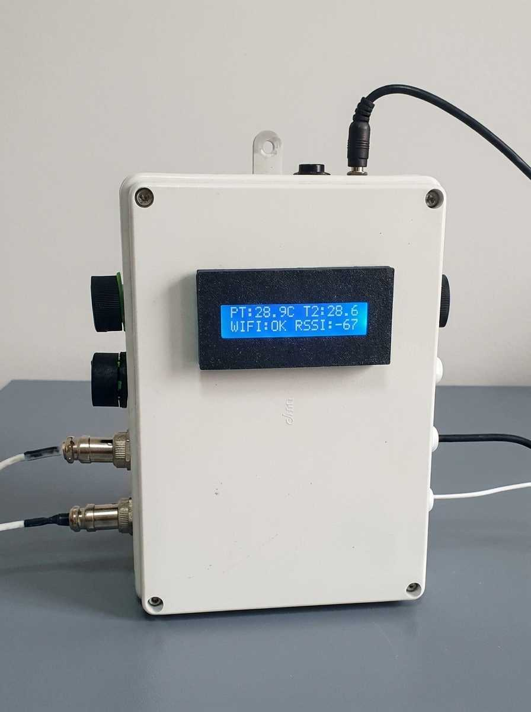
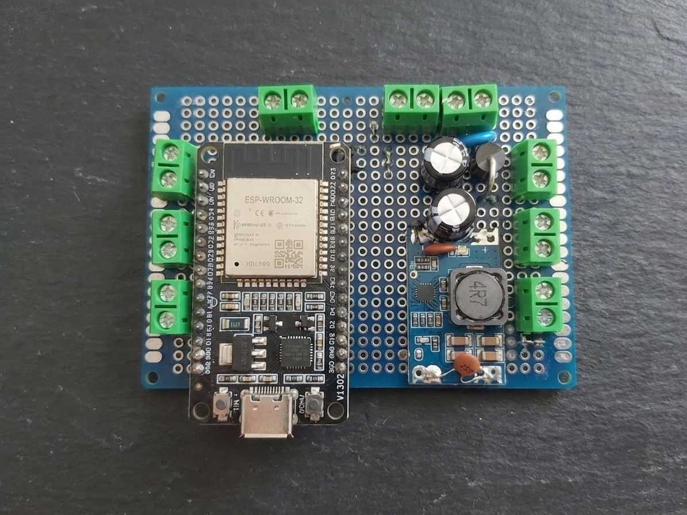
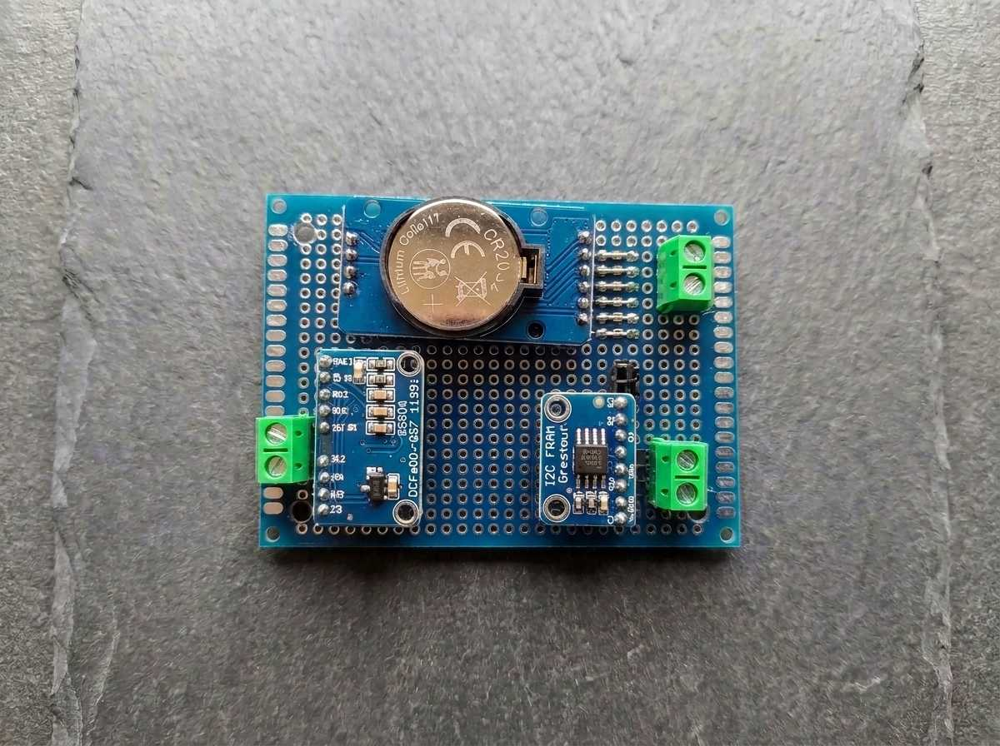
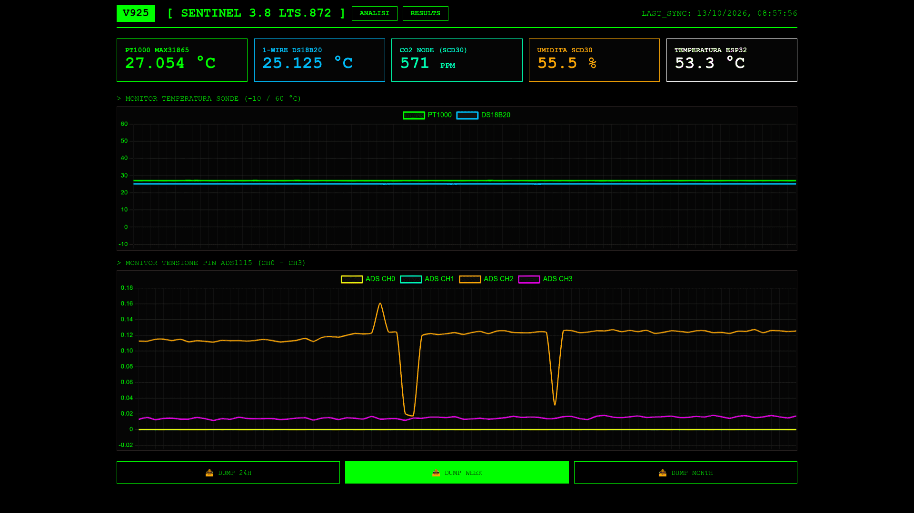
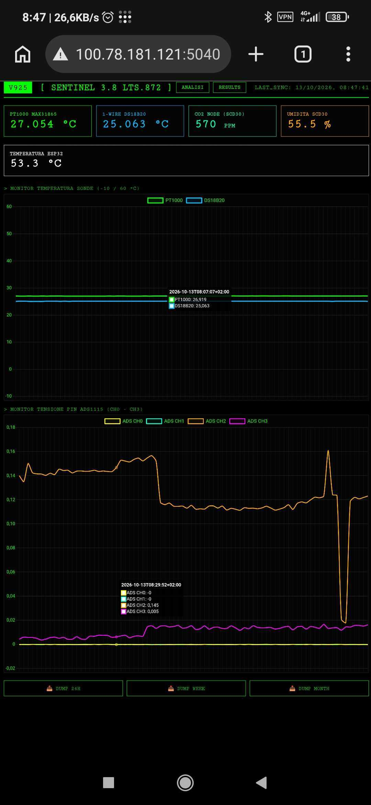
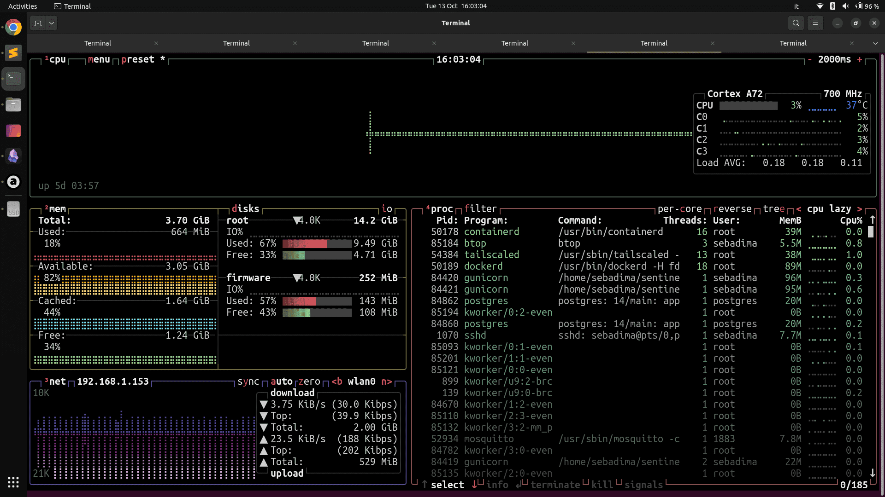
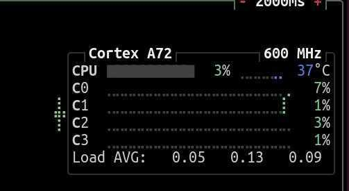

Sentinel è progettato per ridurre alcuni problemi tipici dei sistemi IoT, come la perdita di dati in caso di disconnessione dalla rete, l'usura delle memorie non volatili e i blocchi del firmware causati da problemi di comunicazione o da componenti software che impediscono al sistema di rispondere.

[](https://github.com/sebadima/sentinel)

## Specifiche del nodo operativo

<div class="sentinel-header-specs" style="display: flex; gap: 20px; margin-bottom: 30px; font-family: 'Courier New', monospace;">
    <div class="spec-card" style="border-left: 4px solid #00ff00; padding-left: 10px;">
        <span style="font-size: 0.8em; color: #888;">TARGET_CPU</span><br>
        <strong>ESP32-WROVER-E</strong>
    </div>
    <div class="spec-card" style="border-left: 4px solid #00ff00; padding-left: 10px;">
        <span style="font-size: 0.8em; color: #888;">STORAGE_TECH</span><br>
        <strong>FRAM (ZERO_SD)</strong>
    </div>
    <div class="spec-card" style="border-left: 4px solid #ff0000; padding-left: 10px;">
        <span style="font-size: 0.8em; color: #888;">SURGE_PROTECTION</span><br>
        <strong>Alimentazione (15.0V)</strong>
    </div>
</div>

## Architettura hardware di Sentinel

Sentinel Node è basato su un modulo **ESP32-WROVER-E** e utilizza un'architettura di acquisizione locale progettata per continuare a raccogliere e conservare dati anche in assenza di connessione al server.

La scheda integra un convertitore **ADS1115 a 16 bit** per i segnali analogici, una memoria **FRAM MB85RC256V da 32 KB** per il buffer circolare persistente e un **RTC DS3231** per mantenere i riferimenti temporali indipendentemente dalla rete. Per le misure di temperatura utilizza un'interfaccia **MAX31865 con sonda PT1000** e un sensore digitale **DS18B20**.

I dispositivi comunicano tramite bus I²C, SPI e 1-Wire. Un display LCD locale mostra i messaggi diagnostici durante l'avvio; il firmware, organizzato con **FreeRTOS**, utilizza un supervisor e il watchdog hardware per rilevare e recuperare alcune condizioni di blocco.

I dati vengono conservati localmente e inviati al backend Flask quando la connessione è disponibile. Il firmware mantiene i record in coda fino alla conferma del server, secondo la logica store-and-forward.

L'obiettivo è separare l'acquisizione sul campo dalla disponibilità della rete, così da consentire al nodo di continuare a lavorare localmente anche quando il server non è raggiungibile, entro i limiti della memoria disponibile.

---



*Scheda inferiore: modulo ESP32-WROVER-E e stadio di alimentazione basato su convertitore buck Mini 560, per la generazione delle linee di alimentazione a 5 V e 3,3 V.*

---



*Sottosistema di acquisizione e persistenza: memoria FRAM MB85RC256V da 32 KB, RTC DS3231 per la gestione dell'ora, ADC ADS1115 a 16 bit e circuiti di interfaccia per i sensori.*

---



*Dashboard web responsive per la consultazione delle misure e dello storico delle rilevazioni.*

---



*Interfaccia mobile: panoramica degli indicatori di stato del nodo.*



*Visualizzazione dei livelli di CO2 e dello storico delle rilevazioni.*



*Interfaccia mobile per la consultazione degli alert, delle soglie di warning e delle informazioni diagnostiche.*

---

## Architettura del buffer e persistenza dati

### Ring buffer persistente su memoria FRAM

Il nodo utilizza una memoria FRAM **MB85RC256V da 32 KB**, collegata al bus I²C all'indirizzo `0x50`. La FRAM consente di aggiornare i dati senza effettuare i cicli di cancellazione preventiva tipici di altre memorie non volatili.

- **Scrittura senza cancellazione preventiva:** consente aggiornamenti diretti della memoria, senza un ciclo di cancellazione dei blocchi prima della scrittura.
- **Resistenza ai cicli di scrittura:** il valore dichiarato dal produttore dipende dalla specifica del componente e dalle condizioni di funzionamento; per il valore esatto occorre fare riferimento al datasheet della versione installata.
- **Verifica dei record:** ogni record utilizza una signature a 32 bit (`0xDEADBEEF`) e un checksum a 16 bit. Questi controlli permettono di riconoscere record con struttura o contenuto non valido, ma non garantiscono da soli il recupero da ogni scrittura interrotta.

### Supervisor FreeRTOS e watchdog hardware

Il firmware utilizza un task dedicato (`vSupervisorTask`), assegnato al Core 0, per controllare alcune condizioni di possibile blocco:

| Checkpoint | Timeout critico | Condizione monitorata |
| :--- | :--- | :--- |
| `last_loop_tick` | 10 secondi | Mancato avanzamento del ciclo principale `loop()` |
| `last_i2c_read` | 45 secondi | Mancanza prolungata di attività di lettura I²C |
| `last_net_sync` | 180 secondi | Mancata sincronizzazione con il server |

Se uno dei checkpoint supera il timeout previsto, il Supervisor smette intenzionalmente di alimentare il watchdog hardware dell'ESP32. Se il watchdog non viene rinnovato entro il timeout configurato (`WDT_TIMEOUT = 30s`), la MCU viene riavviata.

Durante l'aggiornamento OTA, il comportamento del Supervisor viene modificato per evitare che il watchdog interrompa un aggiornamento in corso.

### Gestione dei timestamp

- **RTC hardware indipendente:** il DS3231, collegato al bus I²C all'indirizzo `0x68`, mantiene l'ora anche quando il nodo non è connesso alla rete, purché il circuito RTC disponga dell'alimentazione necessaria.
- **Validità dell'ora:** il firmware controlla il flag OSF (Oscillator Stop Flag) del DS3231. Se il flag è attivo, l'ora mantenuta dall'RTC potrebbe non essere valida; il nodo segnala la condizione tramite il warning `0x08`. L'eventuale risincronizzazione dell'ora richiede una fonte temporale attendibile.
- **Fuso orario:** la stringa POSIX `CET-1CEST,M3.5.0,M10.5.0/3` descrive le regole di ora solare e legale per l'Italia. La sua applicazione dipende dalla configurazione software del nodo o del server.

---

## Sequenza diagnostica all'avvio (POST)

A ogni avvio o reset, la MCU esegue una routine di POST (Power-On Self Test) divisa in sei stadi sequenziali. I log operativi vengono mostrati sul display LCD 1602, collegato all'indirizzo I²C `0x27`.

1. **KERNEL CORE:** analisi della causa del riavvio, ad esempio panic, watchdog o brown-out, e verifica della memoria heap disponibile. La soglia indicata dal firmware è superiore a 100 KB.
2. **I2C RECOVERY:** generazione di nove impulsi di clock sul pin SCL per tentare di recuperare un bus I²C bloccato.
3. **DS3231 RTC:** lettura dei registri RTC e controllo del flag OSF.
4. **FRAM TEST:** test di scrittura e lettura del pattern `0xAA` nelle aree di memoria previste dalla routine diagnostica.
5. **MAX31865 PT1000:** lettura dei registri di fault via SPI per rilevare le condizioni di errore segnalate dall'interfaccia RTD, ad esempio disconnessioni o anomalie elettriche.
6. **1-WIRE BUS:** controllo della linea collegata al GPIO 33 per rilevare eventuali condizioni anomale, compresi possibili cortocircuiti verso GND.

---

## Sincronizzazione dei dati con il server

Il firmware comunica con il backend Python Flask usando una strategia **store-and-forward**.

1. **Invio dei record arretrati:** dopo una disconnessione, il firmware tenta di inviare i record storici conservati nella FRAM, mantenendone l'ordine cronologico.
2. **Conferma del server:** il puntatore di lettura in FRAM (`FRAM_READ_PTR_LOC`) viene incrementato solo quando il server restituisce una risposta HTTP `201 Created`, secondo la logica implementata nel firmware. In caso di errore, il record può essere ritentato.
3. **Invio dei dati correnti:** quando la coda arretrata è stata svuotata, il firmware riprende l'invio dei dati correnti con la frequenza prevista dalla configurazione, indicata qui in 15 secondi.

Esempio di payload JSON:

```json
{
  "version": 924,
  "status": 0,
  "drift": 0,
  "timestamp": "2026-08-15T09:55:59+02:00",
  "timestamp_utc": 1786780559,
  "voltage_0": 18.46,
  "voltage_1": 13.74,
  "ads_ch0": 1.245,
  "ads_ch1": 0.002
}
```

---

## Collegamenti e interfacce hardware

### Dispositivi sul bus I²C (GPIO 21 SDA / GPIO 22 SCL)

| Indirizzo | Dispositivo | Funzione | Tensione logica |
| --- | --- | --- | --- |
| `0x27` | LCD 1602 | Display locale e log diagnostici POST | 3,3 V |
| `0x48` | ADS1115 | Convertitore ADC a 16 bit e quattro ingressi | 3,3 V |
| `0x50` | MB85RC256V | Memoria FRAM per il buffer circolare (32 KB) | 3,3 V |
| `0x68` | DS3231 | RTC hardware e misura di temperatura interna al componente | 3,3 V |

### Bus SPI per l'acquisizione termica PT1000 (MAX31865)

| Pin ESP32 | Segnale SPI | Funzione |
| --- | --- | --- |
| GPIO 25 | MISO | Dati in ingresso verso l'ESP32 |
| GPIO 26 | MOSI | Dati in uscita dall'ESP32 |
| GPIO 27 | SCK | Clock del bus SPI |
| GPIO 32 | CS | Chip Select del MAX31865 |
| `Rref` | - | Resistenza di riferimento dichiarata: **4300 Ω (0,1%)** |

### Bus 1-Wire (GPIO 33)

- **Sonda ambientale:** sensore digitale DS18B20 con resistenza di pull-up da 4,7 kΩ installata sul circuito.
- **Gestione degli errori:** il firmware può usare il valore sentinella `-99.0` e un flag di errore nel JSON per segnalare una lettura non valida, ad esempio in caso di sonda scollegata. Il comportamento esatto dipende dall'implementazione del driver.

---

# Come clonare e caricare il firmware

Il firmware embedded è gestito tramite Git. La compilazione e il caricamento vengono eseguiti con il Makefile presente nella directory `firmware`.

```bash
git clone git@github.com:sebadima/sentinel.git
cd sentinel/firmware/
make upload
```

---

## Sentinel backend (server Flask)

Il backend Flask riceve i dati dal nodo, li salva in PostgreSQL e rende disponibili le API e la dashboard di monitoraggio.

### Requisiti di sistema

- Python 3.10 o successivo
- Database PostgreSQL
- Git e riga di comando

### Installazione dell'ambiente

Per preparare l'ambiente Python e installare le dipendenze:

```bash
cd ../server
make prep
```

Il target `make prep` prepara l'ambiente virtuale `.venv` e installa i pacchetti elencati in `requirements.txt`.

### Configurazione dell'ambiente

Crea il file `.env` a partire dal modello fornito:

```bash
cp env_example .env
```

Configura `.env` con i parametri necessari. Il file contiene credenziali e chiavi che non devono essere pubblicate nel repository.

- `DATABASE_URL`: URL di connessione SQLAlchemy a PostgreSQL, secondo il formato previsto dalle dipendenze installate.
- `OPENAI_API_KEY`: chiave API per le eventuali funzioni di analisi basate su modelli linguistici; parametro opzionale.
- `OPENAI_API_BASE`: endpoint API alternativo, se supportato dalla configurazione.
- `MODEL`: nome del modello utilizzato dalle funzioni di analisi.

### Migrazioni del database

Applica le migrazioni per creare o aggiornare lo schema del database:

```bash
.venv/bin/flask --app app db upgrade
```

### Avvio del server

Avvia il server tramite il target previsto dal Makefile:

```bash
make
```

L'indirizzo di accesso dipende dalla configurazione di Gunicorn e dalla rete del server. Se l'applicazione ascolta sulla porta `5040`, l'URL sarà:

```text
http://<IP_SERVER>:5040
```

Per visualizzare gli indirizzi IP assegnati al server, puoi usare:

```bash
hostname -I
```

### Suite di test

I test verificano le API e i principali flussi di acquisizione e ingestione dei dati, secondo la configurazione del progetto.

```bash
make test
```

## Conclusione

Sentinel è un sistema di monitoraggio edge pensato per raccogliere e conservare dati anche quando la connessione al server non è disponibile. Utilizza una memoria FRAM per il buffer locale, un RTC hardware per i riferimenti temporali e un firmware FreeRTOS con meccanismi di diagnostica e watchdog. Il backend Flask e la dashboard permettono di consultare i dati raccolti e monitorare il funzionamento del nodo.

Per informazioni, assistenza tecnica o supporto, puoi scrivere a **lab@robotdazero.it**.
